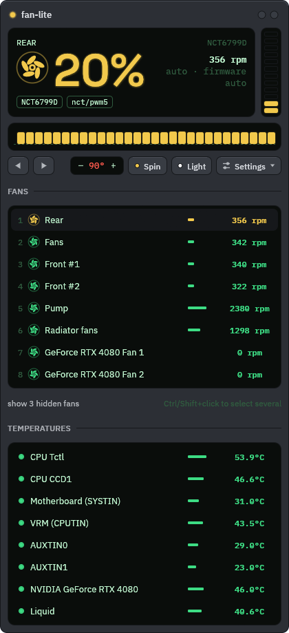
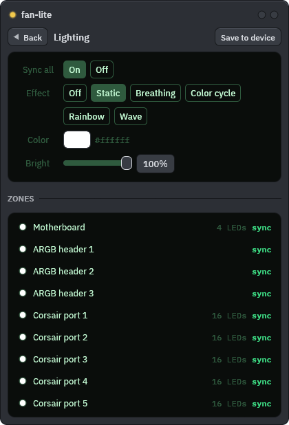

# Fan lite

A small fan controller for Windows, written in Rust with egui. It was inspired by
[FanControl](https://github.com/Rem0o/FanControl.Releases) but does much less, on purpose.

<p align="center">
  
  &nbsp;
  
</p>

- **Monitors:** CPU temperature (AMD Ryzen, through SMN), motherboard temperatures and fan RPM
  (Nuvoton NCT6797D/98D/99D Super I/O), and NVIDIA GPU temperature and fans (NVML).
- **Controls:** motherboard fan headers, NVIDIA GPU fans, and NZXT Kraken AIO coolers
  (Kraken 2023, Kraken Elite 2023, Kraken Z3) over USB: pump and radiator fans, plus their
  liquid temperature as a curve sensor.
- **Modes per fan:** Auto (firmware or driver decides), Manual %, or a temperature curve.
- **Dependencies:** `eframe` (glow renderer) and `windows-sys`. Nothing else.
- **Look:** [peripheral-lite](https://github.com/Skyttehehe/peripheral-lite)'s "Gunmetal" skin with its own window frame. It uses the same trimmed
  IBM Plex ("LL Sans/Mono") and Space Grotesk fonts, embedded from `third_party/fonts`
  (SIL OFL 1.1, licence texts included).

## Download

Get `fan-lite-<version>-windows-x64.zip` from [Releases](../../releases), unzip it anywhere and
run `fan-lite.exe`. Each zip has a `.sha256` file next to it for checking the download.
There is no installer; settings live in `%APPDATA%\fan-lite`.

## Updates

- fan-lite looks for a new release on GitHub when it starts and once a day while it runs.
  When there is one, **Update vX.Y.Z** appears in the title bar.
- Click it and fan-lite downloads the release zip, checks its SHA-256, swaps its exe and
  restarts into the new version. The fans are back under firmware control for a second or
  two during the restart.
- Settings → **Version** has **Check now**, and **Auto** turns the automatic check off.
- If Windows refuses to start the new version (Smart App Control can block unsigned apps),
  fan-lite puts the old exe back and keeps running.
- v0.2.0 and older have no updater: download v0.2.1 or newer by hand once.
- Only one fan-lite runs at a time; starting it again shows a message instead.

## Requirements

- Windows 10/11 x64, running as administrator. The exe asks for elevation itself.
- [PawnIO](https://pawnio.eu) installed, for CPU and motherboard access. FanControl and
  LibreHardwareMonitor install it as well. The signed PawnIO modules are embedded in the exe
  (`third_party/pawnio`, LGPL-2.1).
- An NVIDIA driver, for GPU support. It is optional.

Hardware that isn't supported is reported under **Notices** and skipped.

## Usage

```
fan-lite.exe            # GUI
fan-lite.exe --probe    # read-only hardware report, also saved to %APPDATA%\fan-lite\probe.txt
fan-lite.exe --listen-test
```

`--listen-test` makes one fan group loud at a time, marked by beeps, so you can hear which one
is noisy. It hands every fan back when it's done and stops at 90 °C.

**Tray icon**
- Closing the window (the round × or Alt+F4) hides fan-lite to the notification area by the
  clock. Fan control keeps running.
- Hover the amber fan icon to see each fan's speed and the CPU temperature.
- Left-click the icon to show the window again. Right-click it for **Open** and **Quit**.
- Only **Quit** really exits, and it hands every fan back to firmware control.
- Windows 11 puts new icons in the overflow menu (the **^** arrow). Drag the icon onto the
  taskbar to keep it visible.

**Fans tab**
- Every fan starts in **Auto**, and fan-lite never writes to a fan in Auto.
- Pick **Manual** or a **Curve** to take control of a fan.
- Click a name to rename it. Headers show as `Fan #1..#7` because the physical order isn't
  known; to find one, spin it up in Manual and watch which RPM changes.
- Drag fans up and down the list to reorder them; the order is saved.
- **Ctrl+click** marks several fans and **Shift+click** marks a range. With several marked,
  any change in Settings (mode, speed, curve, Min, ramp) applies to all of them, and only
  the field you changed is copied. Esc or Clear goes back to one fan.

**NZXT Kraken AIO**
- fan-lite talks to the cooler over USB, the way NZXT CAM does, so CAM isn't needed.
  **Close NZXT CAM first:** only one program can control the Kraken at a time, and fan-lite
  leaves it alone while CAM is running.
- **Liquid** is the coolant temperature. It moves slowly and is what the radiator sees, so
  it's the best sensor for radiator fans and the pump. Presets automatically use it and
  switch to liquid-temperature tables (idle ~28-32 °C, gaming ~35-42 °C).
- The Kraken remembers the last speed it was given. When fan-lite quits, or a Kraken
  channel is set back to Auto, it gets a gentle liquid-temperature curve that the cooler
  runs on its own (pump 40-100 %, fans 30-100 %). Every speed fan-lite sends also includes
  100 % at 59 °C liquid as a device-side failsafe.
- The pump never goes below 20 %.

**Calibrate** (fan settings → Test)
- Steps a fan or pump from 100% down to 20% (never below its minimum) for about 45 s and
  measures the speed at each step. The result is saved and tells you:
  - whether it responds to PWM at all (if not, curves can't change its speed: normal for
    some pumps; for a fan, check the header's DC/PWM mode in the BIOS),
  - whether it looks like a pump (still fast at 20%), with a one-click AIO pump preset.
- It stops by itself if a watched sensor gets within 10 °C of the critical temperature or a
  write fails, and the emergency override always wins.

**Curves**
- Presets tuned for a Ryzen 7000 X3D's Tctl: **Quiet**, **Balanced**, **Performance**, and
  **AIO pump** (steady, never below 60%). Pick one from a fan's Curve mode or add copies in
  the Curves view, then fine-tune.
- Drag points to move them, double-click to add a point, right-click a point to remove it.
- Hysteresis applies only while the temperature is falling, so cooling never lags.
- **Smooth** averages the temperature over a few seconds before the curve, so short CPU
  spikes don't make the fans surge. The emergency override always uses the raw reading.
- With an AIO, the pump usually sits on the CPU header and the radiator fans elsewhere:
  give the radiator fans Quiet/Balanced and the pump the AIO pump preset.

**Lighting** (the **Light** button)
- **Sync all** puts one effect on every RGB zone: Static, Breathing, Color cycle, Rainbow,
  Wave or Off, with colour, speed and brightness. Click a zone to give it its own effect or
  to leave it alone.
- Effects run on the devices themselves, so lighting costs no CPU. fan-lite only writes when
  an effect changes, and never touches a light until you turn on Sync or set a zone.
- **Save to device** stores the lighting in the device's flash, so it's there after a restart
  without fan-lite. It's a separate button because flash wears out.
- Supported: **ASUS Aura** mainboard controllers over USB (the board's LEDs and its ARGB
  headers). Armoury Crate's "ASUS AURA SYNC lighting service" must be stopped; fan-lite
  leaves the board's lighting alone while it runs.
- Supported: **Corsair iCUE Commander Core XT**, one zone per RGB port (and the 3-pin strip).
  The hub only takes colours from software, so fan-lite renders every effect itself (about
  20 frames a second while one animates, otherwise one frame every 4 s) and the hub goes back
  to its own stored lighting when fan-lite quits. iCUE must be closed. The hub
  is left alone if fans are plugged into it (software mode would take over their speed).
- Not yet: RAM and GPU lighting. NZXT Kraken 2023 coolers have no lighting control over USB.

**Sensors tab**
- Watch or unwatch sensors, set the critical temperature, and set the update interval.

Settings live in `%APPDATA%\fan-lite\config.txt`, a plain text file that's safe to edit by hand.

## Safety

These checks run every tick, in priority order:

1. **Emergency:** if any *watched* sensor reaches the critical temperature (default 90 °C),
   every controlled fan goes to 100%. The emergency clears 5 °C below the threshold.
2. **Sensor fault:** if a curve's sensor is missing or implausible for 3 ticks, its fans go to 100%.
3. **Write faults:** if writing to a fan fails 3 times in a row, the fan is handed back to firmware
   and marked *fault* until you change its settings.
4. **Floors and ramps:** a per-fan minimum % (default 20; set it to 0 to allow a stop), the
   hardware minimum (from NVML), and limits on how fast the speed may change per second.
5. **Stall warning:** shown if a fan is commanded to at least 30% but reports 0 RPM for 5 s.
6. **Restore on exit:** quitting from the tray menu, or a panic, restores the original BIOS fan
   mode and NVIDIA's default fan control. Closing the window only hides it; control continues.
   - A forced kill (Task Manager) cannot be caught, so fans keep their last speed until reboot.
   - The firmware's own critical-temperature fan override is never touched.

Bus access is serialised with the same global mutexes LibreHardwareMonitor, FanControl and
HWiNFO use. ASUS firmware may still access the Super I/O chip without taking that mutex.
FanControl and LHM have the same limitation.

## Building

Requires Rust 1.95+ with the MSVC toolchain.

```
cargo build --release
```

- Set `FANLITE_NO_UAC=1` to build without the admin manifest. That is handy for development;
  hardware access then degrades to NVML read-only.
- `cargo test` runs the unit tests: control logic, safety, config format, register decoding and
  the Kraken protocol. They need no hardware and no admin rights.
- **CI:** every push runs `cargo fmt --check`, `cargo clippy -D warnings`, the tests and a release
  build on Windows, and uploads the build as an artifact. Pushing a `vX.Y.Z` tag that matches
  `Cargo.toml` runs the same checks again and publishes a release only if they all pass.
- With **Smart App Control** on, Windows sometimes blocks freshly compiled build scripts and
  test binaries (os error 4551). Re-running the command usually gets past it.

## Footprint (Ryzen 7800X3D / RTX 4080, release build)

- **Exe size:** about 6 MB, of which about 1.5 MB is fonts.
- **Idle CPU:** about 0.4% of one core with the window open and a 1 s tick. Hardware reads take
  about 1.6 ms per tick.
- **Working set:** about 90 MB, mostly the OpenGL driver.
- **Window states:** the GUI repaints only when the engine has new data or on input. While the
  window is minimized, nothing is rendered.
- **Spinning fan icons:** while a fan is spinning and the window is visible, the GUI redraws at
  about 60 fps (measured: ~5 % of one core, ~0.3 % of the whole CPU on a 7800X3D). Turn this
  off with the **Spin** toggle to go back to one redraw per tick.

## License

MIT (`LICENSE`). The embedded fonts are SIL OFL 1.1 (`third_party/fonts`) and the PawnIO
modules are LGPL-2.1 (`third_party/pawnio`); their licence texts ship in every release zip.
